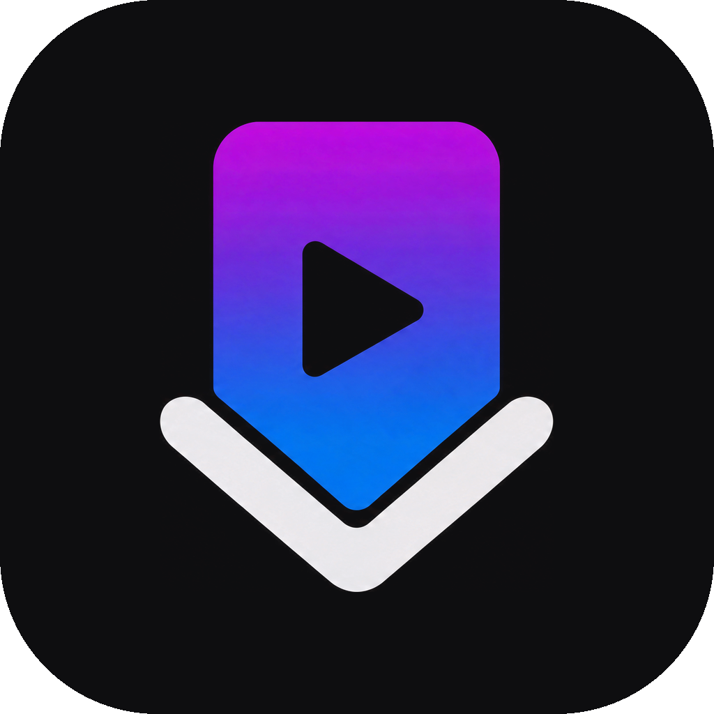

  

<h1 align="center">AxGrab</h1>

  Scarica video e audio da YouTube, Instagram, TikTok, X, Facebook, Twitch, Reddit e altri 1800+ siti. 
  <b>Creato da nonsonoAxel</b> · un'interfaccia grafica per <a href="https://github.com/yt-dlp/yt-dlp">yt-dlp</a>

  <a href="https://github.com/nonsonoAxel/AxGrab/releases/latest"><b>⬇ Scarica l'ultima versione</b></a>

---

## Come si usa
1. Vai su **[Releases](https://github.com/nonsonoAxel/AxGrab/releases/latest)** e scarica **AxGrab.exe**.
2. Doppio clic. È un **unico file**: niente installazione, puoi tenerlo dove vuoi (Windows 10 o 11).
3. Al primo avvio AxGrab scarica da solo i componenti che gli servono (circa 150 MB, serve internet).
4. Incolla un link, scegli video o audio e la qualità, premi **Scarica**.

> **"Windows ha protetto il PC"?** Succede perché l'EXE non ha una firma digitale a pagamento.
> Clicca *Ulteriori informazioni → Esegui comunque*.

Quando esce una nuova versione, AxGrab te lo dice all'avvio: scarichi il nuovo `AxGrab.exe` e sostituisci
quello vecchio. Impostazioni e cronologia restano.

## Funzioni
- Anteprima (miniatura, titolo, durata, risoluzione massima) prima di scaricare
- Video MP4 (Max / 4K / 1440p / 1080p / 720p / 480p) oppure solo audio M4A (il più veloce) o MP3
- Più link insieme, uno per riga: vanno tutti in coda, con download contemporanei configurabili
- Avanzamento, velocità, tempo rimanente, annulla e riprova
- Playlist intere (opzione nelle impostazioni)
- **Cookie dal browser** (Firefox, Zen, Helium, Brave, Edge, Chrome) per contenuti che richiedono l'accesso
  e per la verifica anti-bot di YouTube. AxGrab conserva una copia dei soli cookie dei siti video, così
  funzionano anche con il browser aperto e l'analisi è più rapida.
- Cronologia con ricerca: apri il file, mostra nella cartella, scarica di nuovo
- Aggiornamento di yt-dlp con un clic (se un sito smette di funzionare, aggiorna)
- Avviso automatico delle nuove versioni di AxGrab
- Disinstallazione completa dall'app

## Dove finiscono i dati
Componenti (yt-dlp, ffmpeg, Deno), impostazioni, cronologia, copia dei cookie e log stanno in
`%LOCALAPPDATA%\AxGrab` (di solito `C:\Users\<nome>\AppData\Local\AxGrab`). Il percorso esatto è indicato
nell'app in *Impostazioni → Dati e disinstallazione*, da dove puoi anche **disinstallare tutto**: l'app
elimina quella cartella, l'EXE e i suoi collegamenti. I video scaricati non vengono toccati.

## Se qualcosa non va
- **"YouTube chiede di confermare che non sei un bot"**: in *Impostazioni → Cookie dal browser* scegli il
  browser in cui hai fatto l'accesso a YouTube.
- **"… è aperto e blocca i suoi cookie"**: chiudi quel browser una volta e riprova.
- **Un sito ha smesso di funzionare**: *Impostazioni → Aggiornamenti → yt-dlp → Aggiorna*.
- **È lento**: *Impostazioni → Dati e disinstallazione → Log* apre `axgrab.log`, con i tempi di ogni analisi
  e download. Attenzione: il log contiene i link che hai scaricato, non condividerlo in pubblico.

---

## Per lo sviluppo
| File | Cosa contiene |
|---|---|
| `app.py` | motore: yt-dlp, coda, cookie, finestra, aggiornamenti |
| `ui/index.html` | interfaccia (aperta in un browser parte in modalità demo) |
| `assets/logo.png` | logo originale su fondo nero |
| `make_icon.py` | dal logo genera `ui/logo.png`, `axgrab.ico` e `assets/icona-1024.png` |
| `crea-exe.bat` | ricrea `AxGrab.exe` (serve Python 3.12) |

### Pubblicare una nuova versione
1. In `app.py` aumenta `APP_VERSION` (es. `1.0.0` → `1.0.1` per correzioni, `1.1.0` per novità).
2. Esegui `crea-exe.bat`.
3. Su GitHub: **Releases → Draft a new release**, tag `v` + versione (es. `v1.0.1`), scrivi le novità e
   allega il nuovo `AxGrab.exe`. Il tag deve corrispondere ad `APP_VERSION`: è quello che AxGrab confronta
   per avvisare gli altri.
4. Se hai modificato il codice, caricalo anche nel repository (*Add file → Upload files*).

## Licenza
[MIT](LICENSE) © 2026 Andrea Santarelli. AxGrab scarica e usa [yt-dlp](https://github.com/yt-dlp/yt-dlp)
(Unlicense), [FFmpeg](https://ffmpeg.org) (GPL) e [Deno](https://deno.com) (MIT), che restano dei rispettivi autori.

Usa AxGrab solo per contenuti che hai il diritto di scaricare.
