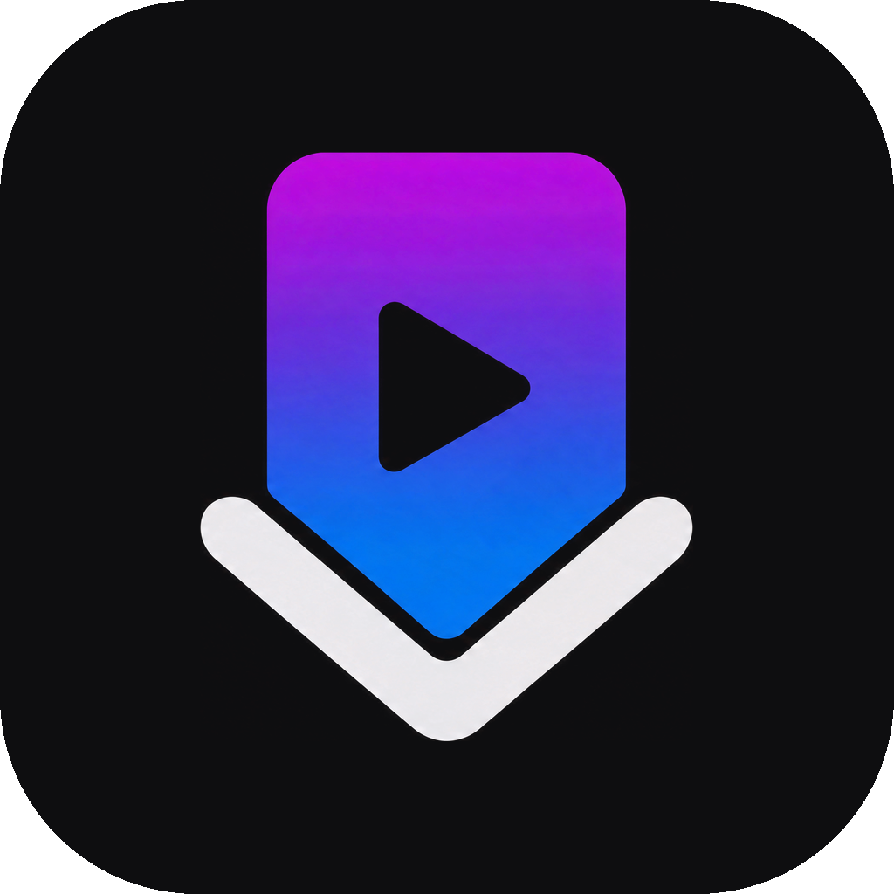

  

<h1 align="center">AxGrab</h1>

  Scarica video e audio da YouTube, Instagram, TikTok, X, Facebook, Twitch, Reddit e tanti altri siti. 
  <b>Creato da <a href="https://github.com/nonsonoAxel">nonsonoAxel</a></b> · un'interfaccia grafica per <a href="https://github.com/yt-dlp/yt-dlp">yt-dlp</a>

  <a href="https://github.com/nonsonoAxel/AxGrab/releases/latest"><b>⬇ Scarica l'ultima versione</b></a>

---

## Come si usa
1. Vai su **[Releases](https://github.com/nonsonoAxel/AxGrab/releases/latest)** e scarica **AxGrab.exe**.
2. Doppio clic. È un **unico file**: niente installazione, puoi tenerlo dove vuoi (Windows 10 o 11).
3. Al primo avvio AxGrab scarica da solo i componenti che gli servono (circa 150 MB, serve internet).
4. Incolla un link, scegli video o audio e la qualità, premi **Scarica**.

> **"Windows ha protetto il PC"?** Succede perché l'EXE non ha una firma digitale a pagamento.
> Clicca *Ulteriori informazioni → Esegui comunque*.

Quando esce una nuova versione, AxGrab te lo dice all'avvio: scarichi il nuovo `AxGrab.exe` e sostituisci
quello vecchio. Impostazioni e cronologia restano.

## Funzioni
- Anteprima (miniatura, titolo, durata, risoluzione massima) prima di scaricare
- Video MP4 (Max / 4K / 1440p / 1080p / 720p / 480p) oppure solo audio M4A (il più veloce) o MP3
- Solo la miniatura, in JPG alla massima risoluzione
- **Trascrizione** (Whisper, tutto sul tuo PC, niente inviato online): modalità **Testo** per i link e
  **Trascrivi un file…** per audio e video già sul PC. Salva un `.txt` e i sottotitoli `.srt`.
  Il motore (9 MB) e il modello (da 31 MB a 1 GB) si scaricano **solo se usi la trascrizione**, scegliendo
  il modello in *Impostazioni → Trascrizione*, dove trovi per ognuno peso, qualità in italiano e in
  inglese e una stima dei tempi sul tuo PC. AxGrab riconosce anche i modelli già scaricati da altre app
  e li usa senza riscaricarli. Con una **scheda NVIDIA** puoi attivare l'accelerazione (si scarica una
  volta, 653 MB): su una RTX 5080 la trascrizione è circa 7 volte più veloce che sul processore
- Più link insieme, uno per riga: vanno tutti in coda, con download contemporanei configurabili
- Avanzamento, velocità, tempo rimanente, annulla e riprova
- Playlist intere (opzione nelle impostazioni)
- **Cookie dal browser** (Firefox, Zen, Helium, Brave, Edge, Chrome) per contenuti che richiedono l'accesso
  e per la verifica anti-bot di YouTube. AxGrab conserva una copia dei soli cookie dei siti video, così
  funzionano anche con il browser aperto e l'analisi è più rapida.
- Cronologia con ricerca: apri il file, mostra nella cartella, scarica di nuovo
- Aggiornamento di yt-dlp con un clic (se un sito smette di funzionare, aggiorna)
- Avviso automatico delle nuove versioni di AxGrab
- Disinstallazione completa dall'app

## Dove finiscono i dati
Componenti (yt-dlp, ffmpeg, Deno e, se usi la trascrizione, Whisper e i suoi modelli), impostazioni,
cronologia, copia dei cookie e log stanno in
`%LOCALAPPDATA%\AxGrab` (di solito `C:\Users\<nome>\AppData\Local\AxGrab`). Il percorso esatto è indicato
nell'app in *Impostazioni → Dati e disinstallazione*, da dove puoi anche **disinstallare tutto**: l'app
elimina quella cartella, l'EXE e i suoi collegamenti. I video scaricati non vengono toccati.

## Se qualcosa non va
- **"YouTube chiede di confermare che non sei un bot"**: in *Impostazioni → Cookie dal browser* scegli il
  browser in cui hai fatto l'accesso a YouTube.
- **"… è aperto e blocca i suoi cookie"**: chiudi quel browser una volta e riprova.
- **Un sito ha smesso di funzionare**: *Impostazioni → Aggiornamenti → yt-dlp → Aggiorna*.
- **È lento**: *Impostazioni → Dati e disinstallazione → Log* apre `axgrab.log`, con i tempi di ogni analisi
  e download. Il log riporta solo i siti (es. `www.youtube.com`), non i link completi, e si svuota
  insieme alla cronologia.

---

## Per lo sviluppo
| File | Cosa contiene |
|---|---|
| `app.py` | motore: yt-dlp, coda, cookie, finestra, aggiornamenti |
| `trascrizione.py` | Whisper: catalogo dei modelli con le impronte ufficiali, riconoscimento dei modelli sul PC, consigli |
| `ui/index.html` | interfaccia (aperta in un browser parte in modalità demo) |
| `assets/logo.png` | logo originale su fondo nero |
| `make_icon.py` | dal logo genera `ui/logo.png`, `axgrab.ico` e `assets/icona-1024.png` |
| `firma.py` | firma delle release: crea `AxGrab.exe.sig`; l'app lo controlla prima di aggiornarsi |
| `crea-exe.bat` | ricrea `AxGrab.exe` e lo firma (serve Python 3.12) |
| `requirements-build.txt` | versioni esatte delle librerie usate per creare l'EXE |
| `selfcheck.py` | controllo rapido della logica senza finestra: `.venv\Scripts\python.exe selfcheck.py` |

### Pubblicare una nuova versione
1. In `app.py` aumenta `APP_VERSION` (es. `1.0.0` → `1.0.1` per correzioni, `1.1.0` per novità).
2. Esegui `crea-exe.bat`: crea `AxGrab.exe` e, accanto, il file di firma `AxGrab.exe.sig`.
3. Su GitHub: **Releases → Draft a new release**, tag `v` + versione (es. `v1.0.1`), scrivi le novità e
   allega **sia `AxGrab.exe` sia `AxGrab.exe.sig`**. Il tag deve corrispondere ad `APP_VERSION`: è quello
   che AxGrab confronta per avvisare gli altri, ed è scritto dentro la firma.
4. Se hai modificato il codice, caricalo anche nel repository (*Add file → Upload files*).

## Licenza
[MIT](LICENSE) © 2026 nonsonoAxel. AxGrab scarica e usa [yt-dlp](https://github.com/yt-dlp/yt-dlp)
(Unlicense), [FFmpeg](https://ffmpeg.org) (GPL) e [Deno](https://deno.com) (MIT), che restano dei rispettivi autori.

Usa AxGrab solo per contenuti che hai il diritto di scaricare.
